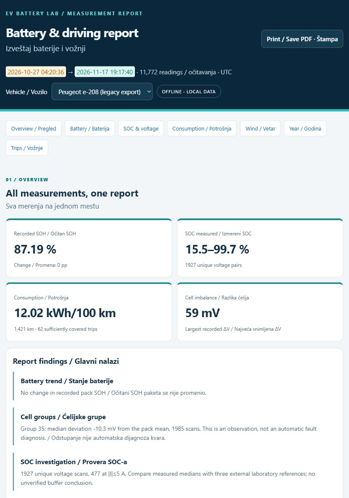
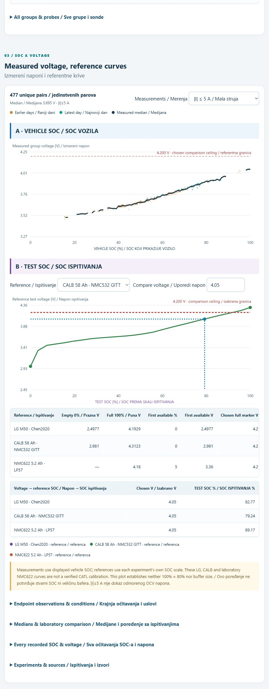
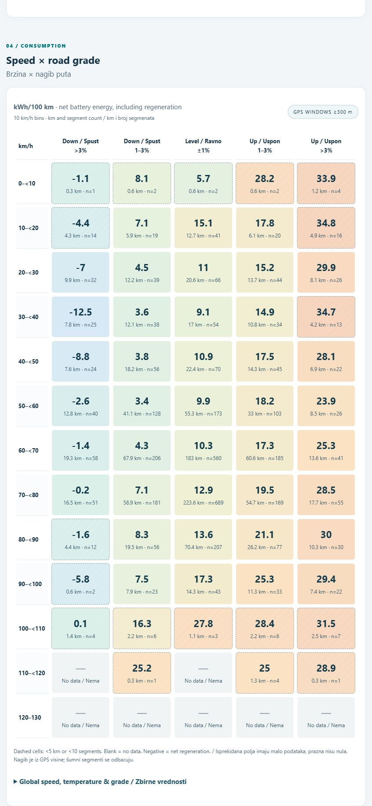
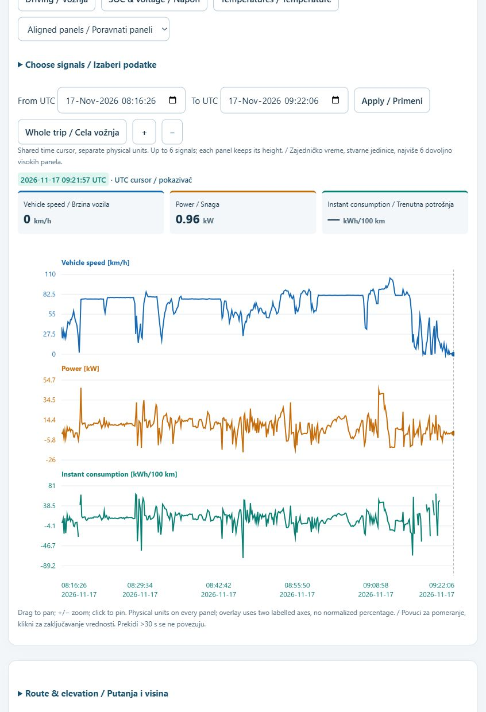
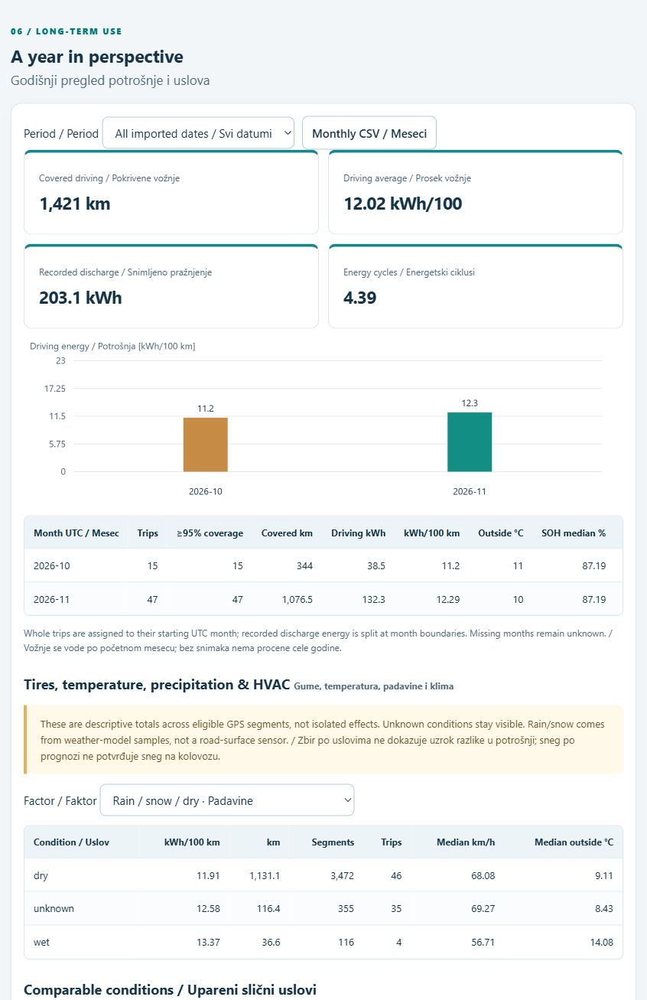

# EV Battery Lab

Android battery monitoring for Peugeot/Stellantis e-CMP and Renault Zoe, with a Windows tool for analysing exported measurements.

**[Download apps and source](https://github.com/milimi-test/ev-battery-lab/releases/latest)** · **[Build and customization guide](UPUTSTVO_ZA_DORADU.md)** · **[Export analyser](analyzer/README.md)** · **[Srpski](#srpski)**

## English

### Why this project exists

Battery Lab began as an owner's investigation of battery voltage and health in a Peugeot e-208. The dashboard percentage did not seem consistent with the voltages being observed. The initial hypothesis was: **could 100% on the dashboard correspond to roughly 80% on a cell reference curve?**

The program was built to record actual OBD readings, follow pack and cell-group voltages, track recorded SOH changes and compare measurements over time. That hypothesis is a **research question, not a verified claim about Peugeot/CATL SOC or hidden buffers**. A reference from another chemistry/cell, temperature or test method cannot establish this car's absolute SOC. The report shows raw observations, medians, external test references and the limits of each comparison.

### Report screenshots

The report starts with all measurements together; individual and longer trips are optional. Earlier dates are amber, the latest recorded day is teal. These screenshots show aggregate battery/report views; raw exports and GPS routes are not published.







### What it does

- Reads actual battery data through a compatible Bluetooth OBD adapter: SOC, pack SOH, voltage, current, power, available energy and supported cell-group voltages/temperature probes.
- Records trips, charging sessions and phone GPS; compares consumption, speed, elevation and available vehicle temperatures with interactive charts.
- Provides offline satellite/terrain maps of Serbia and neighbouring areas, streets, contours, charging locations and road-route planning within the packaged routing coverage.
- Estimates charging time and driving range with an adjustable arrival reserve. Voltage-based SOC models are comparisons, not a verified CATL calibration or a measurement of hidden battery buffers.
- Keeps histories and adapter settings separate by vehicle profile. English is the default; Serbian is selectable under **More → Settings → Language / Jezik**.
- Exports measurement ZIPs for the separate offline desktop analyser. The analyser produces an interactive HTML report and CSV tables without uploading the ZIP, with monthly trends, dated tire/HVAC context, matched conditions, separate vehicle/test SOC scales and energy-equivalent cycling history.

### Vehicle profiles

| Family | Profiles included |
|---|---|
| Stellantis e-CMP 50 kWh | Peugeot e-208, e-2008; Opel Corsa-e, Mokka-e; Citroën ë-C4; DS 3 Crossback E-Tense |
| Renault Zoe phase 1 | Q210 / R240 22 kWh; Q90 / R75 / R90 / R110 ZE40 |
| Renault Zoe phase 2 | R110 ZE40; R110 / R135 ZE50 |

These are **15 implemented profiles**, not a claim that every variant has been tested on a physical vehicle. Peugeot e-208 field measurements informed development. Zoe protocol checks use synthetic ECU responses; physical Zoe validation remains necessary. Select the actual generation and installed battery. Two cars of the same profile do not yet have separate VIN-based histories. Unsupported readings stay unavailable; pack SOH is not copied into individual cells. [Protocol details and limitations](design/VOZILA_021.md).

### Install and connect

1. Download `e208-battery-lab-0.22.apk` from [Android 0.22](https://github.com/milimi-test/ev-battery-lab/releases/tag/v0.22), copy it to an **Android 8+** phone and open it. Allow APK installation for the app you use to open the file if Android requests it.
2. Select your vehicle on the home screen. Pair the compatible Bluetooth adapter in Android settings, then select it in Battery Lab. Development used a Vgate iCar Pro 2S; adapters differ in support for long ISO-TP replies.
3. Allow Bluetooth and precise location access when prompted. Close any other app holding the adapter connection. Turn on the vehicle and connect.
4. The recording switch controls storage. The bulb keeps the screen awake. The power button stops monitoring and exits. GPS is tied to monitoring/trip state.
5. Export measurements from **More → Settings**, then open the ZIP in **Battery Lab Analyzer**. Multiple overlapping exports are deduplicated by vehicle and timestamp.

The APK is a debug-signed development build. Installing an update requires the same signing key; building on another computer creates a different debug key. Export your data before replacing an installation. Source packages contain no signing keys.

### Maps, estimates and data

Map bounds are 17–25° E / 40–48° N. Street/charger coverage extends beyond Serbia; the routing graph does not cover every surrounding country. Charging stations are an offline snapshot, not live availability: green means explicitly free energy; blue includes paid and unknown pricing. Weather lookup uses Open-Meteo online and sends the queried location. The analyser itself is offline.

Range rings are straight-line estimates, while road routes are longer and affected by conditions. Missing sensor values, stale arrays and recording gaps must not be interpreted as zero. BMS SOH, modelled capacity and individual group readings are not a laboratory battery-health certificate. The app does not unlock, reset or reprogram the BMS.

### Build, customize and contribute

Use **JDK 17 / Android SDK 35** and the included Gradle Wrapper. For a Git clone or GitHub code ZIP, first download the APK and `SHA256SUMS.txt` from [Android 0.22](https://github.com/milimi-test/ev-battery-lab/releases/tag/v0.22) and restore its offline map assets (Python 3.11+):

```powershell
python tools/restore_offline_assets.py e208-battery-lab-0.22.apk --checksums SHA256SUMS.txt
```

Then build:

```powershell
.\gradlew.bat assembleDebug
```

Output: `app/build/outputs/apk/debug/app-debug.apk`. Large map assets are distributed inside the APK rather than duplicated in Git history. The restore tool copies only those layers locally. Their metadata and preparation tools are in the repository. The first build downloads Gradle/Maven dependencies.

- [English then Serbian guide: build, maps, chargers, new vehicles and translations](UPUTSTVO_ZA_DORADU.md)
- [Map preparation scripts](tools/maps/README.md)
- [Analyzer use and calculation methods](analyzer/README.md)
- [Contributing and reporting issues](CONTRIBUTING.md)
- [Release notes](CHANGELOG.md) · [Data sources and rights](NOTICE.md)

## Srpski

### Zašto je program nastao

Program je nastao za praćenje napona i stanja baterije Peugeota e-208, jer je vlasniku procenat prikazan na instrument tabli delovao nelogično u odnosu na očitane napone. Polazna sumnja bila je: **da li 100% na tabli zapravo odgovara približno 80% na referentnoj krivoj ćelije?**

Cilj je da se to proverava stvarnim OBD merenjima, praćenjem napona paketa i ćelijskih grupa, očitanog SOH i promena kroz vreme. **Ovo je hipoteza, a ne potvrđen podatak o Peugeot/CATL bateriji ili njenim baferima.** Krive drugih ćelija i laboratorijskih ispitivanja služe poređenju; nisu fabrička kalibracija konkretnog automobila.

Analizator 0.2 prvo prikazuje zbirni izveštaj svih merenja, a zatim omogućava pregled pojedinačnih ili dužih vožnji. Sadrži sve SOC/napon zapise, medijane, matricu potrošnje na svakih 10 km/h i poređenje vetra samo kada postoje dovoljno slični segmenti. Raniji datumi su narandžasti, poslednji dan tirkizan. Slike iznad prikazuju zbirne podatke; privatne GPS putanje i ZIP merenja nisu objavljeni.

### Šta aplikacija radi

Battery Lab čita stvarne OBD podatke baterije, snima vožnje i punjenja, prikazuje GPS putanju, grafikone, temperature i podržane napone ćelijskih grupa. Ima offline mape Srbije i okruženja, punjače, planiranje rute, procenu dometa i vremena punjenja. Windows program **Battery Lab Analyzer** iz ZIP izvoza pravi lokalni HTML izveštaj i CSV tabele.

Uključeno je **15 profila**: šest Stellantis modela sa baterijom 50 kWh i devet Zoe varijanti navedenih u tabeli iznad. Fizičko povezivanje nije potvrđeno za svaku varijantu; Zoe provere protokola koriste sintetičke odgovore. Istorije su odvojene po profilu, ali ne i za dva primerka istog profila. Nedostajuća očitavanja ostaju prazna.

### Instalacija i upotreba

1. Preuzmi **APK 0.22** iz [Android izdanja](https://github.com/milimi-test/ev-battery-lab/releases/tag/v0.22) i instaliraj na Android 8 ili noviji.
2. Izaberi stvarni model/generaciju i bateriju, upari Bluetooth OBD adapter i izaberi ga u aplikaciji. Zatvori drugu aplikaciju koja koristi adapter. Za razvoj je korišćen Vgate iCar Pro 2S.
3. Dozvoli Bluetooth i preciznu lokaciju. Uključi vozilo i poveži se. Prekidač snimanja uključuje čuvanje, lampica drži ekran budnim, a dugme za isključivanje zaustavlja nadzor i izlazi.
4. Srpski biraš u **More → Settings → Language / Jezik**. Izvezi ZIP iz podešavanja i otvori ga desktop analizatorom. Izaberi više izvoza za dugoročni pregled; ponovljeni zapisi se spajaju.

APK je razvojna verzija sa debug potpisom. Za nadogradnju je potreban isti ključ. Pre zamene instalacije izvezi podatke. U javnom projektu nema privatnih ključeva niti ličnih izvoza vožnji.

### Tumačenje i dorada

Krug je procena vazdušnog dometa, a ne dužina puta. Zelena oznaka punjača znači potvrđeno besplatnu energiju; plava uključuje naplatu i nepoznatu cenu. Katalog nema stanje zauzetosti uživo. Mape pokrivaju 17–25° E / 40–48° N, dok rutiranje ne pokriva sve okolne zemlje. Vremenska prognoza koristi internet i šalje lokaciju servisu Open-Meteo; analizator radi lokalno.

SOC iz napona nije potvrđena CATL kalibracija. SOH BMS-a i procena kapaciteta nisu laboratorijski test. Aplikacija ne otključava, resetuje ni preprogramira BMS. Nedostajući podaci i prekidi snimanja jasno se razlikuju od nule.

**[Kompletno uputstvo, prvo engleski pa srpski](UPUTSTVO_ZA_DORADU.md)** objašnjava izgradnju APK-a, dodavanje mapa, punjača, vozila i prevoda. Velike mape su u APK-u; posle preuzimanja koda vrati ih pomoću `tools/restore_offline_assets.py`, kako je prikazano iznad, pa pokreni Gradle. Za program za analizu pogledaj **[njegovo uputstvo](analyzer/README.md)**. Izvori, licence tuđih materijala i status prava izvornog koda su u [NOTICE.md](NOTICE.md).
